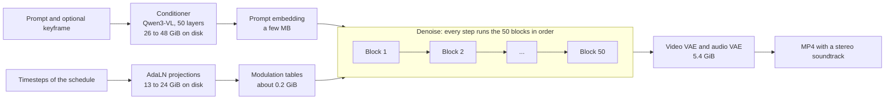
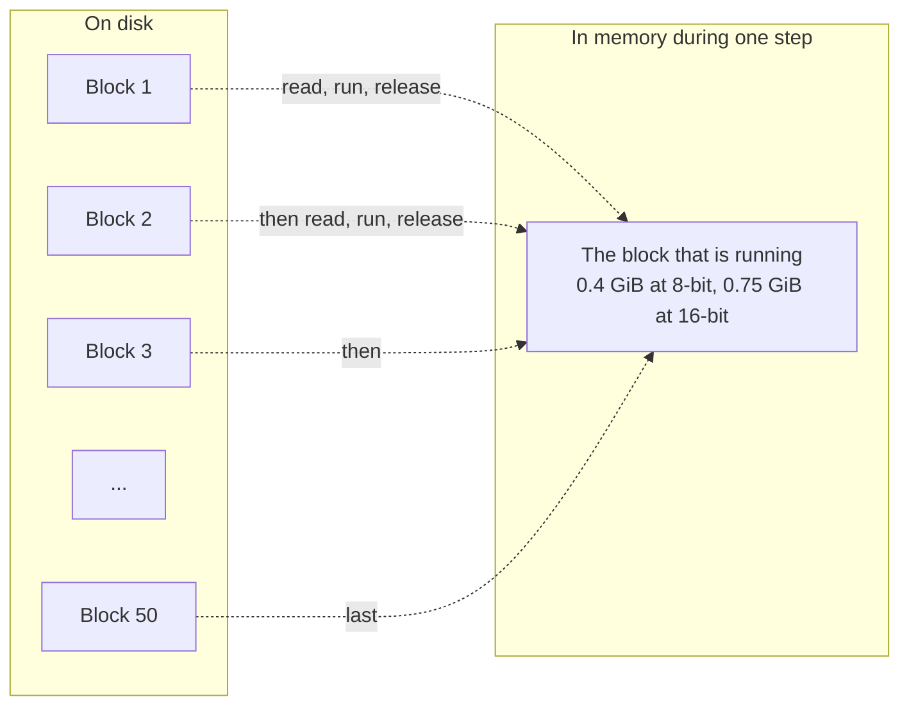

# MiniMax-H3 Memory, Speed And Quantization

MiniMax-H3 has 59 billion parameters across its transformer and its conditioner. This page explains
how MLX-Gen runs it in a fraction of the memory those weights occupy, what each mechanism costs in
time, how the quantized packages compare with the released 16-bit weights, and which tests stand
behind every number. For commands, prompting and sizing see
[MiniMax-H3 video with audio](minimax-h3.md); for the quantization policy of every model family see
[Quantization](quantization.md).

## Summary

Peak memory of one `960x544`, 124-frame, 8-step clip (`minimax-h3-turbo-544p`), as the
whole-process physical footprint on an Apple M5 Max with 128 GB:

| Weights | Default | `--low-ram` | `--stream-blocks --low-ram` |
| --- | ---: | ---: | ---: |
| 16-bit, as released (`AbstractFramework/minimax-h3-bf16`) | 54.4 GiB | 44.0 GiB | 11.7 GiB |
| 8-bit (`AbstractFramework/minimax-h3-8bit`) | 37.0 GiB | 26.3 GiB | 11.1 GiB |
| Mixed 4-bit (`AbstractFramework/minimax-h3-4bit`) | 32.5 GiB | 21.9 GiB | not measured |

- **Same clip in every mode.** The three modes write byte-identical MP4 files for the same weights,
  prompt and seed. The modes change where weights wait between uses, not what is computed.
- **Speed.** `--low-ram` and `--stream-blocks` each cost a few percent of a clip's time; see
  [Speed](#speed).
- **Quality.** The 8-bit package is within the 16-bit model's own numerical noise by a factor of
  1.2 to 2.0 and keeps the sharpness of the 16-bit clips. The mixed 4-bit package is further away
  and measurably softer; see [Quality By Width](#quality-by-width).

Smallest Mac memory each combination completed a clip on (see
[Tested Machine Sizes](#tested-machine-sizes) for how these were run):

| Weights | Default | `--low-ram` | `--stream-blocks --low-ram` |
| --- | --- | --- | --- |
| 16-bit | 96 GB | 64 GB | 32 GB |
| 8-bit | 48 GB | 36 GB | 24 GB |
| Mixed 4-bit | not tested | 32 GB | not tested |

## What A Run Holds In Memory

A clip is made in three stages, and each stage needs different weights:



| Part | 8-bit | 16-bit | When it is needed | Where it waits |
| --- | ---: | ---: | --- | --- |
| Conditioner (50 Qwen3-VL layers, token embeddings, vision tower) | 26.0 GiB | 48.0 GiB | For under a second, to encode the prompt | On disk; read one layer at a time during the encode |
| AdaLN projections (one per block, 13B parameters) | 12.9 GiB | 24.2 GiB | Once per schedule, to compute the modulation tables | On disk; read block by block for that one pass |
| Transformer blocks, token refiner, heads | 20.0 GiB | 37.5 GiB | At every denoise step | In memory, or on disk with `--stream-blocks` |
| Turbo adapter | 1.3 GiB | 1.3 GiB | At every denoise step | In memory |
| Video and audio VAE | 5.4 GiB | 5.4 GiB | For a keyframe, and for the decode | On disk until their first use |

On top of the weights a run needs working memory for the packed sequence (about 2 to 4 GiB at
`960x544`) and the MLX buffer cache (up to 8 GiB by default, 1 GB with `--low-ram`).

### The Conditioner Is Read For The Length Of An Encode

The conditioner turns the prompt into an embedding once per prompt. Its 50 layers run one after
another, so MLX-Gen reads a layer from disk, runs it and releases it before reading the next. The
encode peaks at 3.2 GiB for a text prompt and 4.6 GiB with a keyframe, at 16-bit, and takes about 3
seconds when the files are in the system file cache. The embedding of a prompt is kept, so
repeating a prompt does not read the conditioner again.

### AdaLN Projections Become Tables

Each transformer block has a projection that turns the timestep into six modulation tables. Its
input is the timestep alone, and a run uses a handful of timesteps that are all known before the
first step. MLX-Gen therefore computes every block's tables for the whole schedule in one pass over
the projections on disk (about 3 seconds), and never holds the projections. The tables are the
values the projection would produce during the run. A schedule's tables are kept for the next clip
with the same steps, shifts and keyframe use; the two most recently used schedules stay.

An adapter that trains the per-block AdaLN projections needs them in memory to apply to, so with
such an adapter the projections are loaded and the tables are not used. The lightx2v Turbo adapters
train attention and feed-forward layers only.

### VAEs Are Read At Their First Use

The video VAE encoder is read when a keyframe is encoded, and the decoders when the first clip is
decoded. They stay in memory for the following clips.

### `--low-ram`

`--low-ram` lowers the MLX buffer cache from 8 GiB to 1 GB and frees the transformer before the
decode. With several seeds in one command the transformer is read again for each seed.

### `--stream-blocks`

The transformer is a chain of 50 blocks. At every denoise step the packed sequence goes through
block 1, then block 2, and so on to block 50, and each block is used once per step. While one block
runs, the weights of the other 49 are idle.



By default all 50 blocks are in memory for the whole run. With `--stream-blocks` each block is read
from disk just before it runs and released right after, so the transformer costs one block of
memory instead of 20 GiB (8-bit) or 37.5 GiB (16-bit). The blocks are read again at every step:
20 GiB per step at 8-bit and 36 GiB at 16-bit. Every block still runs at every step, and the result
is the same to the last bit.

- Streaming works from a prepared package, or from the source snapshot without `--quantize`. A
  source snapshot quantized at load time would be quantized again at every step, so there the
  option is reported as not applicable and the transformer stays in memory.
- Step time then depends on how fast the disk delivers the blocks. The measurements on this page
  are from the internal SSD of the test machine.
- The CLI prints how much is read per step and from where.

## Usage

```sh
# Default: the transformer in memory, everything else read when it is needed.
mlxgen generate --model AbstractFramework/minimax-h3-8bit --base-model minimax-h3-turbo-544p \
  --prompt "A red fox trots through fresh powder snow in a birch forest at dawn." \
  --seed 42 --output fox.mp4

# Less memory: a smaller MLX cache, and the transformer freed before the decode.
mlxgen generate --model AbstractFramework/minimax-h3-8bit --base-model minimax-h3-turbo-544p \
  --prompt "..." --seed 42 --low-ram --output fox.mp4

# Least memory: the transformer blocks read from disk at every step.
mlxgen generate --model AbstractFramework/minimax-h3-8bit --base-model minimax-h3-turbo-544p \
  --prompt "..." --seed 42 --stream-blocks --low-ram --output fox.mp4

# The released 16-bit weights, from the 16-bit package or from the source snapshot.
mlxgen generate --model AbstractFramework/minimax-h3-bf16 --base-model minimax-h3-turbo-544p \
  --prompt "..." --seed 42 --output fox.mp4
mlxgen generate --model minimax-h3-turbo-544p --prompt "..." --seed 42 --output fox.mp4
```

From Python, `stream_blocks` is a constructor argument and `release_transformer` an argument of
`generate_video`; `mx.set_cache_limit` is the cache part of `--low-ram`:

```python
import mlx.core as mx

from mflux.models.common.config import ModelConfig
from mflux.models.minimax_h3.variants import MiniMaxH3

mx.set_cache_limit(1_000_000_000)
model = MiniMaxH3(
    model_config=ModelConfig.from_name("AbstractFramework/minimax-h3-8bit", base_model="minimax-h3-turbo-544p"),
    model_path="AbstractFramework/minimax-h3-8bit",
    stream_blocks=True,
)
video = model.generate_video(seed=42, prompt="A red fox trots through fresh snow at dawn.")
video.save("fox.mp4", export_json_metadata=True)
```

Without `stream_blocks`, pass `release_transformer=True` to `generate_video` to free the
transformer before the decode. The metadata sidecar records what a run used: `modulation_tables`,
`transformer_blocks_streamed` and `transformer_released`.

## Speed

Wall time of one `960x544`, 124-frame, 8-step clip, each in a fresh process on the 128 GB test
machine in High Power mode:

<!-- speed-table -->

One transformer call on identical inputs, alternating the candidates in one process so that
machine state affects them equally (seconds, mean of three or four calls):

| Canvas | 16-bit in memory | 16-bit streamed | 8-bit in memory | 8-bit streamed |
| --- | ---: | ---: | ---: | ---: |
| `640x352` | 37.5 s | 40.7 s | 40.7 s | 42.1 s |
| `960x544` | 116.6 s | 120.6 s | 120.1 s | 123.1 s |

- Streaming added 3 to 4 seconds per step at 16-bit and 1.5 to 3 seconds at 8-bit, with the weight
  files in the system file cache.
- The 16-bit and 8-bit transformers take the same time per step at `960x544`; at `640x352` the
  16-bit one was about 10% faster.
- With 96 GiB of RAM locked away, which leaves no room for the system to cache the weight files, a
  16-bit streamed clip took 1026 s against 1034 s without the lock.
- A new prompt costs one read of the conditioner (about 3 seconds from the file cache); a new
  schedule costs one pass over the AdaLN projections (about 3 seconds).

## Tested Machine Sizes

Each row is one `960x544`, 124-frame clip generated on the 128 GB test machine while a second
process held the stated amount of RAM locked for the whole run. Locked memory cannot be swapped or
compressed, so the run sees a machine with that much less memory, including less room for the
system file cache. Every clip completed and is byte-identical to the clip of the same weights
generated without a lock.

| Weights | Mode | RAM locked | Mac size emulated | Peak footprint | Time |
| --- | --- | ---: | ---: | ---: | ---: |
| 16-bit | default | 32 GiB | 96 GB | 54.9 GiB | 1008 s |
| 16-bit | `--low-ram` | 64 GiB | 64 GB | 44.0 GiB | 1036 s |
| 16-bit | `--stream-blocks --low-ram` | 96 GiB | 32 GB | 11.6 GiB | 1026 s |
| 8-bit | default | 80 GiB | 48 GB | 37.3 GiB | 1010 s |
| 8-bit | `--low-ram` | 92 GiB | 36 GB | 26.3 GiB | 1613 s |
| 8-bit | `--stream-blocks --low-ram` | 104 GiB | 24 GB | 10.9 GiB | 1010 s |
| Mixed 4-bit | `--low-ram` | 96 GiB | 32 GB | 21.6 GiB | 1262 s |

The 8-bit `--low-ram` run at 36 GB took 60% longer than the same run without a lock: at that size
the transformer and the rest of the system compete for memory. At 36 GB and below,
`--stream-blocks --low-ram` is the faster choice. Other applications' memory counts on a real
machine; close memory-heavy ones before a run near the low end of a range.

At `1344x768`, 124 frames, the default mode peaks at 38.3 GiB with the 8-bit package and 55.7 GiB
with the 16-bit weights.

## Quality By Width

Quantization changes the weights, so it can change the picture. Two measurements compare each
width with the released 16-bit weights.

**Velocity error.** The 16-bit model generates three reference clips (a dialogue shot, a fox in
snow, and the fox from a keyframe; `640x352`, 124 frames, 8 steps, seed 42), and its transformer
inputs are recorded at steps 1, 4 and 7. Each candidate then predicts the velocity on those same
inputs, with its own conditioner's embedding of the prompt, and the result is compared with the
16-bit prediction as a relative RMS error. The noise floor is the 16-bit model itself with its
prompt embedding perturbed by 0.1%: it shows how much the prediction moves for a change far smaller
than any quantization.

<!-- quality-table -->

**Same-seed clips.** Median frame PSNR of each candidate's clip against the 16-bit clip, and the
fine detail of the frames (variance of the Laplacian, as a percentage of the 16-bit clip's):

<!-- clip-table -->

- The noise floor is 3 to 7% of video velocity: the model amplifies any small change, so two runs
  that differ slightly drift apart over the steps. Same-seed PSNR therefore measures how far two
  clips diverge, not which one is better.
- The 8-bit package is 1.2 to 2.0 times the noise floor and keeps the fine detail of the 16-bit
  clips.
- The mixed 4-bit package diverges further and loses 12 to 20% of the fine detail on the two
  text-to-video clips.
- The measurements cover three clips at one seed and one canvas.

### How The 8-bit Weights Are Chosen

MLX stores a quantized layer as groups of 64 weights, each group with its own grid of 256 levels (a
start value and a step). MLX picks every weight's level on a float32 grid and stores the grid at
the layer's own 16-bit precision. With 256 levels that rounding of the grid is as large as one
step, so about one weight in five is then one level away from its nearest. MLX-Gen picks the levels
again on the grid that is stored. The size, the memory and the speed are unchanged, and the weight
error of a layer falls by about a quarter (0.78% to 0.59% on a sampled attention layer). At 6 bits
and below a step is too wide for the rounding to matter, so those widths are quantized as MLX does
it.

## How The Results Were Validated

| Claim | Test |
| --- | --- |
| The staged loading does not change the output | Clips from the 8-bit package and from load-time `--quantize 4` are byte-identical MP4 files to the clips mlx-gen 0.39 wrote from the same weights, at `640x352` and `960x544`, text-to-video and image-to-video |
| A streamed conditioner equals one held in memory | The prompt embeddings of three prompts, one with a keyframe, are bit-identical |
| AdaLN tables equal the projections | The 16-bit transformer with tables predicts exactly the velocity of the 16-bit transformer with its projections in memory (relative error 0.0 on nine recorded inputs) |
| Streamed blocks equal blocks in memory | Bit-identical transformer output at `640x352` and `960x544`, at 16-bit and 8-bit, and byte-identical clips |
| `--low-ram` and `--stream-blocks` do not change the clip | Byte-identical MP4 files against the default mode, for 8-bit and 16-bit |
| A package equals load-time quantization | The clip from `AbstractFramework/minimax-h3-8bit` is byte-identical to the clip from the source snapshot with `--quantize 8` |
| The memory figures | The peak physical footprint the operating system reports for the whole `mlxgen generate` process, from each run's metadata sidecar |
| The machine sizes | Runs with RAM locked by a second process, listed in [Tested Machine Sizes](#tested-machine-sizes) |

The unit tests in `tests/minimax_h3/test_h3_staged_loading.py` and
`tests/common/test_streaming_weight_loader.py` repeat the equalities on small models: streamed
against in-memory conditioner, tables against projections at 16, 8 and 6 bits, streamed against
in-memory blocks with and without an adapter, a whole clip with and without tables, the refusal of
a weight file that changed after the model was loaded, and the 8-bit level choice.

`tools/minimax_h3_memory_probe.py` produces the reference clips, the recorded inputs, the velocity
errors and the alternating timings; `tools/minimax_h3_quant_probe.py ballast --gib N` locks RAM for
the machine-size runs. The reports are in `docs/assets/quantization/minimax-h3/`.

## Limits

- A weight file must not be replaced while a model that reads from it is loaded. Weights that have
  not been read yet would come from the new file, so MLX-Gen checks the files before each deferred
  read and stops with an error when one changed.
- `--stream-blocks` reads 20 to 36 GiB from disk at every step. It was measured on an internal SSD;
  a slower disk lengthens every step by the time of those reads.
- An adapter that trains the per-block AdaLN projections keeps them in memory (12.9 GiB at 8-bit,
  24.2 GiB at 16-bit) and disables `--stream-blocks`.
- `mlxgen prepare` writes a package one component at a time and needs the memory of the largest
  one: 33 GiB for an 8-bit package, 62 GiB for the 16-bit one.
- The machine sizes were emulated on one 128 GB machine; they were not run on Macs of those sizes.
