# MiniMax-H3 Video With Audio

MLX-Gen runs [MiniMax-H3](https://huggingface.co/MiniMaxAI/MiniMax-H3) natively on Apple Silicon:
one text prompt produces a 24 fps video clip **and** a synchronized stereo soundtrack, saved as a
single MP4 with an AAC audio track. The lightx2v [Turbo](https://huggingface.co/lightx2v/Minimax-h3-Turbo)
adapters run the same model in 8 transformer evaluations instead of 50, which is the practical
way to use it locally. Use this page for setup, prompting, sizing, runtime cost, and current
limits; use [API and CLI](api.md#minimax-h3-video-with-audio) for the option table and
[MiniMax-H3 memory, speed and quantization](minimax-h3-memory.md) for how a run keeps most of the
weights out of memory, what that costs in time, and the tests behind the figures.

## What You Get

- **Text-to-video with audio** (`text-to-video` public task): 5 to 15 seconds at 24 fps, stereo
  audio at 32 kHz, any aspect ratio between 1:4 and 4:1 on a 32-pixel grid.
- **Image-to-video with audio** (`image-to-video` public task, `--image-path`): the clip starts from
  your keyframe. The canvas follows the keyframe's aspect ratio at the entry's short edge unless you pass
  `--width`/`--height`, the keyframe is stretched onto that canvas, and it conditions both the latent
  rows and the text sequence (through the Qwen3-VL vision tower), exactly as the reference pipeline does.
- **One soundtrack covering three kinds of sound**: ambient and diegetic sound, a score, and spoken
  dialogue with the speaker's mouth animated to match. See [Prompting](#prompting).
- **Three catalog entries** that share the same weights and differ only in speed defaults:

| Alias | What it runs | Default canvas | Default steps | Flow shifts (video / audio) |
| --- | --- | --- | --- | --- |
| `minimax-h3` | Base model, no adapter | `1344x768` | `50` | `12` / `3` |
| `minimax-h3-turbo` | lightx2v 8-step Turbo adapter trained at 768p | `1344x768` | `8` | `6` / `3` |
| `minimax-h3-turbo-544p` | lightx2v 8-step Turbo adapter trained at 544p, mixed aspect ratios | `960x544` | `8` | `12` / `3` |

The `--steps` value counts transformer evaluations; the schedulers use one more grid point
internally. All three entries resolve to the `MiniMaxAI/MiniMax-H3` repository and the Turbo
entries add their adapter automatically.

## Requirements

MiniMax-H3 is large: a 33B-parameter transformer, a 32B-parameter Qwen3-VL conditioner (of which
MLX-Gen reads the 50 layers the model conditions on, 25.7B parameters), a 2.4B-parameter video VAE
and an audio VAE. A run holds only part of them in memory: the transformer without its per-block
AdaLN projections. The conditioner is read from disk layer by layer for the length of an encode,
the AdaLN projections are read once per schedule to compute modulation tables, and the VAEs are
read at their first use. The released 16-bit weights and the quantized packages run the same way;
[What A Run Holds In Memory](minimax-h3-memory.md#what-a-run-holds-in-memory) describes each part.

| Resource | Requirement |
| --- | --- |
| Memory | The 8-bit package completes a `960x544` clip on a 48 GB Mac with default settings, on 36 GB with `--low-ram` and on 24 GB with `--stream-blocks --low-ram`. The released 16-bit weights complete it on 96 GB, 64 GB and 32 GB in the same three modes. See [Memory By Machine](#memory-by-machine). |
| Disk | 115 GiB for the 16-bit package, 64.3 GiB for the 8-bit package or 44.9 GiB for the 4-bit package, plus 1.4 GB per Turbo adapter. The source snapshot is 134 GiB of weight files. |
| Download | `mlxgen download` fetches a package or the source snapshot together with the Turbo adapter of the `--base-model` you name. Generation never downloads. |
| mlx-gen | 0.40.0 or later for the memory figures on this page. |

### Published Packages

Three packages hold the base weights. Each memory cell is the peak of one `960x544`, 124-frame,
8-step clip and, where it was tested, the smallest Mac memory the run completed on:

| Package | Weights | Disk | Default | `--low-ram` | `--stream-blocks --low-ram` |
| --- | --- | ---: | --- | --- | --- |
| [`AbstractFramework/minimax-h3-bf16`](https://huggingface.co/AbstractFramework/minimax-h3-bf16) | 16-bit, as released | 115 GiB | 54.4 GiB, ran on 96 GB | 44.0 GiB, ran on 64 GB | 11.7 GiB, ran on 32 GB |
| [`AbstractFramework/minimax-h3-8bit`](https://huggingface.co/AbstractFramework/minimax-h3-8bit) | 8-bit transformer and conditioner | 64.3 GiB | 37.0 GiB, ran on 48 GB | 26.3 GiB, ran on 36 GB | 11.1 GiB, ran on 24 GB |
| [`AbstractFramework/minimax-h3-4bit`](https://huggingface.co/AbstractFramework/minimax-h3-4bit) | Mixed: 4-bit conditioner, 6-bit transformer | 44.9 GiB | 32.5 GiB | 21.9 GiB, ran on 32 GB | not measured |

Peak memory is the whole-process physical footprint on an Apple M5 Max with 128 GB. Choose the
package by quality and disk space, and the mode by the memory of your Mac; the three modes write
the same clip. [Memory By Machine](#memory-by-machine) says what each mode does.

- The 16-bit package holds the released weights, repacked: only the 50 conditioner layers the model
  reads, and the video VAE at the 16-bit precision it runs at.
- The 8-bit package is within 1.2 to 2.0 times the 16-bit model's own noise floor and keeps the
  sharpness of the 16-bit clips. Each 8-bit weight's level is chosen on the grid that is stored;
  see [How The 8-bit Weights Are Chosen](minimax-h3-memory.md#how-the-8-bit-weights-are-chosen).
- The mixed 4-bit package is further from the 16-bit weights and loses 12 to 20% of fine detail on
  text-to-video clips, in 19 GiB less disk and about 4.5 GiB less memory than the 8-bit package. Its
  transformer is 6-bit because no part of the transformer tolerates 4-bit better than another.

[Quality By Width](minimax-h3-memory.md#quality-by-width) compares each width with the 16-bit
weights, and [Quantization](quantization.md#minimax-h3-q8-and-mixed-q4) has the per-layer
measurements and side-by-side clips.

Each package holds the base weights and no adapter. Pick the schedule with `--base-model`, and pass
the same option to `mlxgen download` so the matching Turbo adapter is cached:

```sh
mlxgen download --model AbstractFramework/minimax-h3-8bit --base-model minimax-h3-turbo-544p

mlxgen generate --model AbstractFramework/minimax-h3-8bit --base-model minimax-h3-turbo-544p \
  --prompt "..." --seed 42 --output fox.mp4
```

`--base-model minimax-h3-turbo-544p` (or `minimax-h3-turbo`) applies that entry's defaults and
attaches its Turbo adapter on top of the stored weights; omit it for the base 50-step schedule. Do
not pass `--quantize` when loading a package. The repositories are gated: sign in with
`hf auth login` and accept the license terms on the model page once before downloading. Loading a
package reads the part of the transformer that stays in memory; with the files in the system file
cache that takes seconds. The stored weights are the load-time quantization: same-seed clips from a
package and from `--quantize` on the source snapshot are byte-identical files, frames and
soundtrack.

The packages are distributed under the MiniMax H3 Community License, with its `LICENSE` and `NOTICE`
files inside. Read [Current Limits](#current-limits) before downloading.

### Memory By Machine

Three modes trade memory for a few percent of a clip's time, and write the same clip:

| Mode | What it does |
| --- | --- |
| Default | The transformer stays in memory without its AdaLN projections. The MLX buffer cache holds up to 8 GiB. |
| `--low-ram` | The MLX buffer cache is 1 GB, and the transformer is freed before the decode. With several seeds in one command the transformer is read again for each seed. |
| `--stream-blocks --low-ram` | Each of the 50 transformer blocks is read from disk for the length of its call, at every step, so the transformer costs one block of memory. Works from a prepared package, or from the source snapshot without `--quantize`; a request that cannot be met is reported on stderr and the transformer stays in memory. |

The mode to use on each machine size, from the smallest size each combination completed a
`960x544`, 124-frame clip on:

| Mac memory | 8-bit package | 16-bit weights |
| --- | --- | --- |
| 96 GB or more | Default settings | Default settings |
| 64 GB | Default settings | `--low-ram` |
| 48 GB | Default settings | `--stream-blocks --low-ram` |
| 36 GB | `--stream-blocks --low-ram` | `--stream-blocks --low-ram` |
| 32 GB | `--stream-blocks --low-ram` | `--stream-blocks --low-ram` |
| 24 GB | `--stream-blocks --low-ram` | Not tested |

- The 8-bit package also completes on 36 GB with `--low-ram` alone, 60% slower than on a larger
  machine; `--stream-blocks --low-ram` is the faster choice at 36 GB and below.
- The mixed 4-bit package completes on 32 GB with `--low-ram`.
- The sizes were tested on the 128 GB machine with the difference in RAM locked by a second process
  for the whole run; they were not run on Macs of those sizes. Other applications' memory counts:
  close memory-heavy ones before a run near the low end of a range.
- `--stream-blocks` reads 20 GiB (8-bit) to 36 GiB (16-bit) from disk at every step. The figures
  are from an internal SSD; a slower disk lengthens every step.
- At `1344x768`, 124 frames, the default mode peaks at 38.3 GiB with the 8-bit package and
  55.7 GiB with the 16-bit weights. Longer clips need more; see
  [How much memory a length needs](#how-much-memory-a-length-needs).

[MiniMax-H3 memory, speed and quantization](minimax-h3-memory.md) explains the mechanism, lists
every [tested machine size](minimax-h3-memory.md#tested-machine-sizes) with its peak and time, and
gives the [cost in time](minimax-h3-memory.md#speed) of each mode.

### Preparing A Package Yourself

`mlxgen prepare` writes the same packages from the source snapshot. Without `--quantize` it writes
the 16-bit package; `--quantize 8` or `--quantize 4` writes a quantized one:

```sh
mlxgen download --model minimax-h3
mlxgen prepare --model minimax-h3 --path models/minimax-h3-bf16
mlxgen prepare --model minimax-h3 --quantize 8 --path models/minimax-h3-8bit
mlxgen prepare --model minimax-h3 --quantize 4 --path models/minimax-h3-4bit
```

Prepare from `minimax-h3` so the package carries no adapter; a Turbo entry is refused. The package
gets the source tokenizer files, the `LICENSE` and `NOTICE` files and each layer at the width the
policy assigns it; loading reads those widths back from the files. `prepare` writes one component
at a time and needs the memory of the largest one: 33 GiB for an 8-bit package and 62 GiB for the
16-bit one. MiniMax-H3 accepts `--quantize 8` and `--quantize 4` only. The same two values on
`mlxgen generate` quantize the source snapshot at load time, and the 8-bit package equals load-time
`--quantize 8` byte for byte.

## Quick Start

```sh
mlxgen download --model AbstractFramework/minimax-h3-8bit --base-model minimax-h3-turbo-544p

mlxgen generate \
  --model AbstractFramework/minimax-h3-8bit \
  --base-model minimax-h3-turbo-544p \
  --prompt "[Shot 1] Cinematic medium shot, static camera, shallow depth of field. A red fox trots through fresh powder snow in a quiet birch forest at dawn; its breath steams in the cold blue light. Halfway through the clip it stops, ears twitching toward the camera, then bounds forward, kicking up a spray of snow that catches the low sun." \
  --soundscape "Soft rhythmic crunch of paws in dry snow, a faint steady wind through bare branches, and two distant crow caws near the end." \
  --music "Sparse, gentle piano notes with long reverb, slow tempo, contemplative and cold." \
  --seed 42 \
  --output fox.mp4 \
  --metadata
```

The command writes `fox.mp4` (124 frames, `960x544`, 24 fps, stereo AAC) and `fox.metadata.json`.
Switch to `--base-model minimax-h3-turbo` for the 768p adapter and canvas, or omit `--base-model`
for the base 50-step schedule.

On a Mac with less memory, add `--low-ram`, or `--stream-blocks --low-ram`; the clip is the same
file ([Memory By Machine](#memory-by-machine) says which mode fits which machine):

```sh
# Less memory: a 1 GB MLX cache, and the transformer freed before the decode.
mlxgen generate --model AbstractFramework/minimax-h3-8bit --base-model minimax-h3-turbo-544p \
  --prompt "..." --seed 42 --low-ram --output fox.mp4

# Least memory: each transformer block is read from disk at every step.
mlxgen generate --model AbstractFramework/minimax-h3-8bit --base-model minimax-h3-turbo-544p \
  --prompt "..." --seed 42 --stream-blocks --low-ram --output fox.mp4
```

The released 16-bit weights run from the 16-bit package, or from the source snapshot without
`--quantize`:

```sh
mlxgen download --model AbstractFramework/minimax-h3-bf16 --base-model minimax-h3-turbo-544p
mlxgen generate --model AbstractFramework/minimax-h3-bf16 --base-model minimax-h3-turbo-544p \
  --prompt "..." --seed 42 --output fox.mp4

mlxgen download --model minimax-h3-turbo-544p
mlxgen generate --model minimax-h3-turbo-544p --prompt "..." --seed 42 --output fox.mp4
```

The source snapshot is 134 GiB of weight files. Add `--quantize 8` or `--quantize 4` to the last
command to quantize it at load time instead.

To start from an image, add `--image-path` and describe what happens next; the first frame reproduces
the picture and the motion follows the prompt:

```sh
mlxgen generate \
  --model AbstractFramework/minimax-h3-8bit \
  --base-model minimax-h3-turbo-544p \
  --image-path keyframe.png \
  --prompt "Starting from the pictured red fox in the snow, the fox turns its head toward the camera, then trots forward through the powder." \
  --soundscape "Soft crunch of paws in dry snow, faint wind." \
  --music "Sparse piano, slow tempo." \
  --seed 42 --output fox_i2v.mp4 --metadata
```

## Prompting

MiniMax-H3 is trained on a structured prompt with three labelled sections separated by blank
lines:

```text
integrated_multimodal_description: <what happens on screen, shot by shot>

overall_soundscape: <diegetic sound: what the scene itself sounds like>

non_diegetic_music: <score, or "No non-diegetic music; natural sound only.">
```

`--prompt` fills the first section, `--soundscape` the second, and `--music` the third. A prompt
that already contains the section labels (for example one written with MiniMax's
[prompting guides](https://github.com/MiniMax-AI/MiniMax-H3/tree/main/docs)) is passed through
verbatim, so `--prompt-file` works for complete structured prompts. The prompt is tokenized as-is,
without a chat template or special tokens; it may be long, and detailed shot descriptions help.

Describe motion with timing ("halfway through the clip"), name the sounds you expect on impact
events, and state when a shot has no score. The model is guidance-distilled: there is no negative
prompt and no guidance scale.

The three kinds of sound each have a place in the prompt:

- **Ambient and diegetic sound** goes in `overall_soundscape` (`--soundscape`): room tone, weather,
  footsteps, engines, birds, impacts.
- **Music** goes in `non_diegetic_music` (`--music`), or write "No non-diegetic music; natural sound
  only." for silence; music that plays inside the scene (a busker, a radio) belongs in the soundscape.
- **Speech** is written into the description with a speaker id and a dialogue tag:
  `The woman with a warm mid-pitched voice (S1) says: <d>[English] Good morning!</d>`. Give each
  speaker a stable `(S1)`, `(S2)` id and enough identity for a voice (age, gender, pitch, pace); keep
  only the language tag and the exact words inside `<d>`. For narration use the phrase
  `says in an off-screen voiceover` and add that the on-screen lips stay closed. MiniMax lists 11
  stably supported dialogue languages (Arabic, Chinese, English, French, German, Italian, Japanese,
  Korean, Portuguese, Russian, Spanish). `<d>`, `</d>`, `<|cutoff|>` and the lyric and caption markers
  are dedicated tokens of the model's vocabulary; MLX-Gen tokenizes them exactly as the reference does.

## Image-To-Video

`--image-path` selects MiniMax-H3's first-frame mode. The keyframe defines the canvas: its aspect
ratio is mapped onto the entry's geometry (768-pixel short edge for `minimax-h3` and
`minimax-h3-turbo`, 544 for `minimax-h3-turbo-544p`, capped at the entry's pixel budget) on the
32-pixel grid, and the image is stretched onto that canvas. Pass `--width`/`--height` to force a
different canvas; the keyframe is stretched to it. A 16:9 keyframe gives `960x544` on the 544p
entry, a square one `544x544`.

The keyframe reaches the model twice: as noise-augmented condition latents pinned at the start of
the clip, and as a `<Picture 1>` vision block in the text sequence, so the prompt should describe
the *motion* that follows ("the fox turns, then trots forward") rather than re-describe the picture.
The soundtrack is generated as in text-to-video. Metadata records `task: image-to-video`, the
source image path and size, and the resolved canvas. A second, closing keyframe (the reference's
`last_image`) is not exposed yet.

Motion prompts for still keyframes work best when they describe one continuous action and its end
state: "lifts straight up in one smooth, continuous motion, never touching the ground again, and
leaves through the top of the frame" produced a complete takeoff, while "lifts off slowly, hovers for
a moment, then climbs" on the same seed produced a late, partial ascent. Name the parts of the subject
that must stay as they are ("the same fixed landing legs, no wheels"), give the soundscape a
continuous character ("a deep, steady engine roar that builds and then fades") and exclude what you
do not want ("no crackling, no buzzing"). The 544p adapter was trained on `960x544`-class canvases: a
16:9 keyframe lands on its native canvas, while a square keyframe gives `544x544` and still works,
as the takeoff sheet below shows; a portrait keyframe gives a portrait canvas. First-person prompts
work too: the room walkthrough below walks, sits, opens a laptop and turns to a window from one
painted keyframe. Describe object manipulation as one motion about a fixed pivot ("lifts its lid in
one slow, continuous rotation about the hinge at the back") and keep the object anchored ("which stays
in place on the table"); fast hand-object interaction is where the 8-step adapter is least reliable.
See the starship, takeoff and room entries under [Contact Sheets](#contact-sheets) for the complete
prompts.

## Sizing And Duration

- Frames follow the video VAE's `17n + 5` rule, and `--frames` rounds up to the next valid count,
  warning when it does. There are fourteen accepted counts, `124` (5.17 s) through `345` (14.375 s):
  `124, 141, 158, 175, 192, 209, 226, 243, 260, 277, 294, 311, 328, 345`. The duration ceiling
  applies to the rounded count, so `346` and above are rejected rather than rounded to `362`. The
  metadata records both `frames` and the `requested_frames` you asked for.
- Width and height must be multiples of 32. The default 16:9 canvas is `1344x768`; the 544p
  adapter defaults to `960x544`. Portrait and square canvases follow the same 768-pixel short edge
  (`768x1344`, `768x768`) when you omit the size.
- Audio length follows the video: 40 audio latents per second, trimmed to the clip duration.

## Measured Runtime

Apple M5 Max, 128 GB, 8-bit weights, 124 frames, MLX 0.31:

| Route | Canvas | Steps | `generate_video` wall time (denoise + both decodes) |
| --- | --- | --- | --- |
| `minimax-h3-turbo-544p` | `960x544` | 8 | 11 to 17 min per clip (650 to 1011 s over eight clips; a fresh process is fastest, later clips in one process run slower as the machine warms up) |
| `minimax-h3` (base) | `960x544` | 50 | 62 min (3741 s) |
| `minimax-h3-turbo` | `1344x768` | 8 | 34 min (2035 s; about 4.2 min per transformer evaluation) |

Step time is set by attention over the packed sequence, not by the weight width: a 6-bit
projection costs no more than an 8-bit one, so the 4-bit package runs at the speed of the 8-bit
one, and the 16-bit transformer takes the same time per step as the 8-bit one at `960x544`.
`--low-ram` and `--stream-blocks` each cost a few percent of a clip's time; see
[Speed](minimax-h3-memory.md#speed). Times assume the machine is otherwise idle; a clip takes about
twice as long while another process shares the CPU. The 768p step is dominated by attention over a
37,900-row packed sequence;
the 544p canvas is the practical iteration setting on Apple Silicon, and the 768p canvas is the
quality setting for a final render.

For scale, the same fox description through Wan2.2 TI2V-5B (q8, `832x480`, 121 frames at 24 fps,
50 steps, silent) took 23 min on the same machine at a 25 GB MLX peak; its sheet is included below.

## Output Contract

- The MP4 carries the video stream plus one stereo AAC track (32 kHz, 192 kb/s). Pass
  `--no-audio` to skip the audio decode and write a silent clip.
- If the audio cannot be muxed (no `ffmpeg` on `PATH` and the PyAV fallback fails), the video is
  still written and the track is saved next to it as `<output>.wav`; the metadata records why.
- Metadata records `steps` (transformer evaluations, as passed to `--steps`), `video_shift`, `audio_shift`,
  `num_inference_steps` (the scheduler grid, one more than `steps`), `text_tokens`,
  `duration_seconds`, `frames` and `requested_frames`, and the `audio_*` fields (`audio_present`,
  `audio_source: "generated"`, `audio_channels`, `audio_sample_rate`, `audio_duration_seconds`,
  `audio_muxed`, `audio_codec`, `audio_mux_mode`).
- Metadata also records how the run held the transformer: `modulation_tables` (the AdaLN
  projections were used as per-schedule tables), `transformer_blocks_streamed` (`--stream-blocks`
  applied) and `transformer_released` (the transformer was freed before the decode).

## Driving MiniMax-H3 From An Application

`mlxgen capabilities --model minimax-h3-turbo-544p` returns everything an application needs to build
controls for this model without hardcoding its name. Both rows, `minimax-h3.text-video` and
`minimax-h3.first-frame`, publish:

| Field | Value on the 544p entry |
| --- | --- |
| `generates_audio`, `audio_channels`, `audio_sample_rate` | `true`, `2`, `32000` — this route composes a soundtrack with the picture, which is different from a restoration row's `supports_audio_passthrough` |
| `prompt_sections` | One descriptor per structured section, carrying its `key`, the engine's literal `label`, the `option` and `parameter` that fill it, its `role` and whether it is `required` |
| `min_frames`, `max_frames`, `frame_multiple`, `frame_remainder`, `frame_rounding` | `124`, `345`, `17`, `5`, `"up"` |
| `output_fps` | `24.0` — `supports_fps: false` only says you may not choose a rate |
| `default_steps`, `default_width`, `default_height`, `default_frames` | `8`, `960`, `544`, `124` |
| `default_flow_shift`, `default_audio_shift` | `12.0`, `3.0` |
| `supports_flow_shift`, `supports_audio_shift` | `true` |
| `supports_block_streaming` | `true` — the route accepts `--stream-blocks` |
| `supports_text_encoder_release` | `false` — the conditioner is read from disk for the length of an encode and never held, so there is nothing to release |
| `flow_shift_option`, `flow_shift_parameter` | `"--video-shift"`, `"video_shift"` — the same control Wan spells `--flow-shift`, so read the spelling off the row rather than keeping a per-family table |
| `weight_precision`, `unquantized_weights_bytes`, `recommended_quantize`, `validated_quantization_bits` | `"bf16"`, `46074000000`, `8`, `[4, 8]` |
| `measured_runs` | Ten measured runs at 124 frames with their conditions. At `960x544`: the 16-bit and the 8-bit weights with default settings, with `--low-ram` and with `--stream-blocks --low-ram`, and the mixed 4-bit policy with default settings and with `--low-ram`. At `1344x768`: the 8-bit and the 16-bit weights with default settings |
| `max_validated_frames`, `peak_bytes_fixed`, `peak_bytes_per_packed_row` | `124`, and an upper line through the default 8-bit run |
| `supports_guidance`, `supports_negative_prompt` | `false`, `false` — published separately because they are independent properties |

Each catalog entry publishes its own label and defaults, so `minimax-h3-turbo` (`1344x768`) and
`minimax-h3-turbo-544p` (`960x544`) are distinguishable in a model list. The fields are additive:
the audio, duration and default fields are present from capability `schema_version` 13, and
`supports_block_streaming` and the `low_ram` and `stream_blocks` conditions of a measured run from
`schema_version` 17.

Use `prompt_sections[].label` to detect a section a prompt already carries: pairing such a prompt
with the option that fills the same section is refused, since it would send the model two of that
section.

### How much memory a length needs

A run's peak is what stands in memory (the transformer without its AdaLN projections, the Turbo
adapter and, from their first use, the VAEs), plus the MLX cache as it fills, plus working memory
that follows the packed sequence length. The packed sequence length is a deterministic function of
canvas and frame count. It is not two separate axes: a 243-frame `960x544` request (37,730 packed
rows) and a 124-frame `1344x768` request (37,910 rows) cost about the same.

| Request | Packed rows | 8-bit package, default mode | 16-bit weights, default mode |
| --- | ---: | ---: | ---: |
| `960x544`, 124 frames | 19,484 | 37.0 GiB | 54.4 GiB |
| `1344x768`, 124 frames | 37,910 | 38.3 GiB | 55.7 GiB |

`peak_bytes_fixed + peak_bytes_per_packed_row x rows` is an upper line for the 8-bit weights in the
default mode. It passes through the `960x544` run and is 3.6 GB above the measured `1344x768` run:
at these canvases the decode sets the peak, and the slope is the working memory of the denoise. The
mixed 4-bit policy sits 4.8 GB below the line and the 16-bit weights 18.8 GB above it.

That is an estimate of bytes, not a promise that a run fits: other processes' memory counts.
`max_frames` is the decode grid, which holds anywhere; `max_validated_frames` says how far the
measurements go. Before a long run the runtime estimates the peak, refuses what cannot fit at all,
and warns when a request is close enough that other resident processes decide the outcome.

The cache limit is a large lever: a raised `--mlx-cache-limit-gb` adds what it allows to the
footprint, and `--low-ram` tightens the cache to 1 GB and frees the transformer before the decode.
An explicit `--mlx-cache-limit-gb` overrides the tightening; the runtime says so on stderr when it
happens.

Sizes are published in bytes so that no consumer has to guess which unit is meant.
`unquantized_weights_bytes` (43 GiB) is what stands in memory when the weights run unquantized: the
transformer without its AdaLN projections, and the VAEs. Each entry of `measured_runs` carries the
conditions it was measured under: `quantize` (`null` for the 16-bit weights), the canvas and frame
count, the cache limit, and the `low_ram` and `stream_blocks` booleans. A run's
`release_text_encoder` carries the same value as `low_ram`, for consumers that read that name.
Compare the `footprint_bytes` of the run that matches a request against the machine's memory to
choose a width and a mode.

`supports_block_streaming` says the route accepts `--stream-blocks`.
`supports_text_encoder_release` is `false` on these rows: the conditioner is never held in memory,
and `--release-text-encoder` is accepted and has no effect.

## Python

```python
from mflux.models.common.config import ModelConfig
from mflux.models.minimax_h3.variants import MiniMaxH3

model = MiniMaxH3(model_config=ModelConfig.minimax_h3_turbo_544p(), quantize=8)
video = model.generate_video(
    seed=42,
    prompt="A red fox trots through fresh snow in a birch forest at dawn.",
    soundscape="Soft crunch of paws in dry snow, faint wind, two distant crow caws.",
    music="Sparse piano, slow tempo.",
)
video.save("fox.mp4", export_json_metadata=True)
waveform, rate = video.audio.waveform, video.audio.sample_rate  # (2, samples) float32, 32000
```

`generate_video` also accepts `image_path` (first-frame image-to-video), `width`, `height`,
`num_frames`, `num_inference_steps`, `video_shift`, `audio_shift`, `generate_audio`,
`release_transformer`, and `progress_callback`. Progress phases are `start`, `denoise` once per
transformer evaluation, `decode`, and `generated`; the CLI adds `save` and a final `complete` once
the file is written and the soundtrack muxed. Every event also reaches the model's registry, so
`model.callbacks.subscribe_progress(...)` sees the whole run. The unified runtime resolves
`--model minimax-h3*` to this class through `load_generation_model(...)`. Omit `quantize` on the
source snapshot to run the released 16-bit weights.

A prepared package loads with `model_path` and no `quantize` argument. The memory modes of the CLI
map to three settings:

```python
import mlx.core as mx

from mflux.models.common.config import ModelConfig
from mflux.models.minimax_h3.variants import MiniMaxH3

mx.set_cache_limit(1_000_000_000)  # the cache part of --low-ram
model = MiniMaxH3(
    model_config=ModelConfig.from_name("AbstractFramework/minimax-h3-8bit", base_model="minimax-h3-turbo-544p"),
    model_path="AbstractFramework/minimax-h3-8bit",
    stream_blocks=True,  # --stream-blocks
)
video = model.generate_video(seed=42, prompt="A red fox trots through fresh snow at dawn.")
video.save("fox.mp4", export_json_metadata=True)
```

- `MiniMaxH3(..., stream_blocks=True)` reads each transformer block from disk for the length of its
  call. It applies to a prepared package, or to the source snapshot without `quantize`; a request
  that cannot be met is reported on stderr and the transformer stays in memory.
- `generate_video(..., release_transformer=True)` frees the transformer before the decode, as
  `--low-ram` does; the next `generate_video` call reads it again. With `stream_blocks` there is
  nothing to free.
- `release_text_encoder` on `generate_video` and `model.release_text_encoder()` are accepted and
  have no effect: the conditioner is never held in memory.

## Adapters

The Turbo entries load their lightx2v adapter from `lightx2v/Minimax-h3-Turbo` with the effective
scale the adapter was trained with (alpha 8 at rank 128). Pass your own `--lora-paths` to replace
the automatic adapter: the list you pass is the complete list, so a style or character adapter on a
Turbo entry goes together with the Turbo file (the adapters stack on the same layers). The 4-step
768p Turbo adapter (`minimax_h3_fl2v_turbo_4step_v1.2_768p_bf16.safetensors`) works with
`--steps 4 --video-shift 6`.

Steps per adapter, from the lightx2v model specifications: the 544p 8-step adapter (the
`minimax-h3-turbo-544p` entry) is distilled at 8 evaluations and recommended at 8 or 4; the 768p
8-step adapter (`minimax-h3-turbo`) at 8 only; the dedicated 4-step adapters (v0.1 at 544p, v1.0 to
v1.2 at 768p) at 4. Eight evaluations is the setting every included clip uses and the one the
lightx2v Studio runs; four halves the denoise time and is the draft setting, which community
reports describe as softer on detail and weaker on fast motion. MLX-Gen steps the video and audio
streams on their own shifts, as the reference does, so the soundtrack keeps its schedule at any
step count. Measured on the same seed and prompt at `640x352` (the
[step-count sheet](#contact-sheets) below): the 544p 8-step adapter at 4 steps keeps the staging of
its 8-step clip and finishes in a third of the time, the 4-step v1.2 adapter at 4 steps renders a
brighter, more saturated take of the same scene, and running that adapter at 8 steps changes little.
The dedicated 4-step adapter needs `--video-shift 6`; the 8-step adapter keeps the entry's 12:

```sh
mlxgen generate --model minimax-h3-turbo-544p --steps 4 --prompt "..." --seed 42 --output draft.mp4
mlxgen generate --model minimax-h3-turbo-544p --steps 4 --video-shift 6 \
  --lora-paths "hf:lightx2v/Minimax-h3-Turbo/minimax_h3_fl2v_turbo_4step_v1.2_768p_bf16.safetensors" \
  --prompt "..." --seed 42 --output draft.mp4
```

```sh
mlxgen generate --model AbstractFramework/minimax-h3-8bit --base-model minimax-h3-turbo-544p \
  --prompt "Skeletor stands in a torch-lit stone throne room and raises his staff." \
  --lora-paths "hf:lightx2v/Minimax-h3-Turbo/minimax_h3_fl2v_turbo_8step_v1.0_bf16.safetensors" \
               loras/H3_Skeletor_1.4.safetensors \
  --lora-scales 1.0 1.0 --seed 42 --output skeletor.mp4
```

Two key layouts load. PEFT adapters over the diffusers module names (`transformer_blocks.N.attn.to_q`,
`ff.net.0.proj`, `ff.net.2`, the token refiner) are what lightx2v publishes. Community adapters
(civitai, ai-toolkit, the reference `generate.py`, ComfyUI, kohya and musubi-tuner) are trained
against the original checkpoint's names (`blocks.N.attn.qkv_proj`, `attn.out_proj`, `mlp.fc1`,
`mlp.fc2`, `token_refiner.blocks.N`, the `final_layer` and patch projections), with or without a
`diffusion_model.` prefix, in PEFT (`lora_A`/`lora_B`) or kohya (`lora_down`/`lora_up` plus
`.alpha`) naming, and in musubi-tuner's flattened `lora_unet_` form. The runtime maps them onto
our modules the way the diffusers converter does: the fused QKV shares one `lora_A` and splits
`lora_B` into `to_q`/`to_k`/`to_v` row thirds, and `fc1`'s `[gate; value]` halves swap to our
SwiGLU's `[value; gate]`. Scale follows the file: PEFT metadata `alpha` gives `alpha / rank`,
kohya `.alpha` tensors are folded per module, and a PEFT file with neither (how ai-toolkit exports)
runs at `alpha == rank`, the same as ComfyUI and diffusers. The one layout refused is
DiffSynth-Studio's (`.lora_A.default.` over `attn.qkv_proj`), whose fused QKV rows keep the raw
checkpoint's per-head interleaving; loading it silently would apply the rows in the wrong order.
Every metadata export lists the adapter files, their scales and the matched / unmatched key
counts (`lora_application_reports`).

## Current Limits

- **Reference-to-video (Ref2VA) and the closing keyframe (`last_image`) are not available yet.**
  Text-to-video and first-frame image-to-video are.
- The 768p canvas is slow on Apple Silicon (about 5 minutes per step); use the 544p adapter to
  iterate.
- `--quantize` accepts 8 and 4 for this model; without it the released 16-bit weights run. Clips
  longer than 124 frames need more memory than the measured profiles; the runtime estimates the
  peak before a run and refuses what cannot fit.
- A weight file must not be replaced while a model that reads from it is loaded. The conditioner,
  the AdaLN projections, the VAEs and streamed blocks are read after the load, so MLX-Gen checks
  the files before each of those reads and stops with an error when one changed. Load the model
  again after replacing a package.
- An adapter that trains the per-block AdaLN projections keeps them in memory (12.9 GiB at 8-bit,
  24.2 GiB at 16-bit) and disables `--stream-blocks`. The lightx2v Turbo adapters train attention
  and feed-forward layers only.
- `--stream-blocks` reads 20 to 36 GiB from disk at every step. It was measured on an internal SSD;
  a slower disk lengthens every step by the time of those reads. From a source snapshot loaded
  with `--quantize` the option does not apply, and the runtime says so on stderr.
- The machine sizes in [Memory By Machine](#memory-by-machine) were tested on one 128 GB Mac with
  RAM locked, not on Macs of those sizes.
- MiniMax-H3 and the packages derived from it are under the MiniMax H3 Community License. Its grant
  covers the whole world except the European Union, the United Kingdom, the Republic of Korea and the
  United States of America, and its use restrictions follow the weights and the outputs. The package
  repositories are gated on accepting it. Read the `LICENSE` file in the package before you
  download, use or redistribute weights or outputs.

## Verification

Every component is a direct port of the diffusers 0.40 reference implementation and was checked
against it with real weights: the packed layout and per-row timestep plan are bit-exact, the
rectified-flow schedules match `torch.linspace` bit-for-bit on 600 grids, the transformer
(one real block), the Qwen3-VL conditioner (text and image-conditioned: vision tower, image
processor, 3-axis rope index and DeepStack injection), the video VAE encoder/decoder and the audio
VAE encoder/decoder all match at fp32 rounding noise, and the q8 transformer block stays within
1.3e-2 relative RMS of the fp32 reference. Over the full 50-block stack the 8-bit transformer is
4% to 11% from the BF16 weights per denoise step on video and the 6-bit transformer of the 4-bit
package 6% to 15% ([measurements](quantization.md#minimax-h3-q8-and-mixed-q4)). Each package
reproduces the clips of its load-time `--quantize` policy byte for byte.

Reading weights when they are needed does not change the output. A conditioner read layer by layer
gives bit-identical prompt embeddings to one held in memory, the modulation tables equal the output
of the AdaLN projections exactly, streamed blocks give bit-identical transformer output, and the
default, `--low-ram` and `--stream-blocks` modes write byte-identical MP4 files for the same
weights, prompt and seed.
[How The Results Were Validated](minimax-h3-memory.md#how-the-results-were-validated) lists each
claim with its test. The included contact sheets below are the model-backed proof for the shipped
routes.

## Contact Sheets

Each sheet shows eight evenly spaced frames of one clip with the generated track's waveform and
spectrogram on the right; the MP4 next to each sheet in `docs/assets/minimax-h3/` is the playable
proof, and the `prompt_*.txt` files hold the complete structured prompts. Unless a row says
otherwise: `minimax-h3-turbo-544p`, `960x544`, 124 frames, 8 steps, `--quantize 8`, seed 42, Apple
M5 Max. The clips were rendered with mlx-gen 0.34 to 0.37; the published 8-bit package gives the
same scenes with small frame-level differences, and [Quantization](quantization.md#same-seed-clips)
compares the 8-bit and 4-bit packages on the same seed.

**Fox, seed 42** ([clip](assets/minimax-h3/fox_turbo544_q8_seed42.mp4),
[prompt](assets/minimax-h3/prompt_fox.txt)): the backlit fox walks straight toward the camera down
a snowy forest path, stops and faces it halfway through as the prompt asks, then bounds forward
kicking up snow; the very quiet track (about -49 dBFS RMS, peaks at -31 dBFS) carries the paw
crunches and the sparse piano notes under a faint wind.

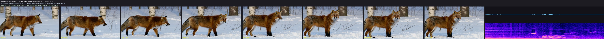

**Fox, seed 43** ([clip](assets/minimax-h3/fox_turbo544_q8_seed43.mp4)): a different fox and
framing from the same prompt, walking out of the birch shadows into the low sun and breaking into a
run at the end; a quiet track (-43 dBFS RMS) with the paw crunches and piano notes spaced along it.

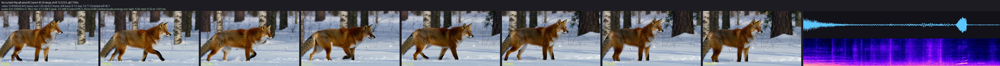

**Turbo versus base, seed 42** ([base clip](assets/minimax-h3/fox_base544_q8_seed42.mp4)): the same
prompt and seed through the 8-step 544p adapter (top, 17 min in a long-running process) and the
50-step base schedule at the same canvas (bottom, 62 min). Both stage the prompt: the fox approaches
down the forest path, pauses facing the camera, then bounds forward through the powder. The base
schedule keeps the fox smaller and deeper in the birch shadows with steadier motion and a similarly
quiet track (-44 dBFS RMS); the adapter frames it closer and brighter. The base entry remains the
reference schedule for the 768p canvas it was released with; for 544p iteration the adapter is the
faster choice at comparable fidelity.

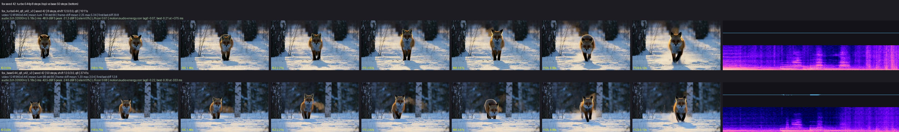

**Fox image-to-video, seed 42** ([clip](assets/minimax-h3/fox_i2v_turbo544_q8_seed42.mp4),
[keyframe](assets/minimax-h3/keyframe_fox.png), [prompt](assets/minimax-h3/prompt_fox_i2v.txt)):
the first frame of the 768p fox clip as keyframe through `minimax-h3-turbo-544p`. Frame 0 reproduces
the keyframe at PSNR 32.3 dB, the fox then looks at the camera and trots to the right with the camera
following, and the quiet track (-26.9 dBFS RMS) carries the paw crunches under the sparse piano the
prompt asks for; 14.8 min for 8 steps and both decodes in a long-running process. The sheet's first
tile is the keyframe.

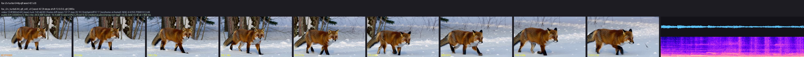

**Starship image-to-video, seed 42** ([clip](assets/minimax-h3/starship_i2v_turbo544_q8_seed42.mp4),
[keyframe](assets/examples/spaceship-snow/01_t2i_spaceship_snow.png),
[prompt](assets/minimax-h3/prompt_starship_i2v.txt)): the repository's `768x432` spaceship-on-snow
image on the 544p entry's native `960x544` canvas. Frame 0 reproduces the keyframe at PSNR 29.4 dB;
the hull, the two side engine pods, the red antenna and the landing legs stay intact while the
engines light up, a ring of ice dust spreads under the hull, the craft rises straight out of the top
of the frame and the dust settles on the empty plain. The track is a continuous low engine roar
(more than 80% of its energy below 200 Hz in every half second, -10.8 dBFS RMS) that builds with the
liftoff and fades as the craft leaves. 15.5 min for 8 steps and both decodes in a long-running
process (10.8 min in a fresh one).

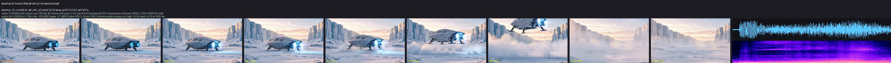

**Spaceship takeoff image-to-video, seed 42** ([clip](assets/minimax-h3/takeoff_i2v_turbo544_q8_seed42.mp4),
[keyframe](assets/i2v_takeoff_source.png), [prompt](assets/minimax-h3/prompt_takeoff_i2v.txt)): the
repository's square `512x512` cargo-ship image gives a `544x544` canvas on the 544p entry. The ship
keeps its shape and landing struts, lifts off in one continuous motion with a snow ring beneath it,
leaves through the top of the frame and the blown snow settles on the empty field; the engine
rumble builds from -21 to -14 dBFS RMS and fades with the climb, and the motion/audio-energy
correlation peaks at 0.71. 5.8 min for 8 steps and both decodes. Frame 0 matches the stretched
keyframe at PSNR 26.5 dB (the source carries film grain).

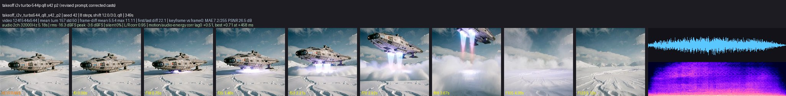

The same keyframe, prompt and seed through `minimax-h3-turbo` ([clip](assets/minimax-h3/takeoff_i2v_turbo768_q8_seed42.mp4))
lands on a `768x768` canvas: the same continuous liftoff with sharper hull plating, portholes and
struts (frame 0 at PSNR 29.3 dB), a -19 dBFS RMS engine track, 17.3 min for 8 steps and both
decodes.

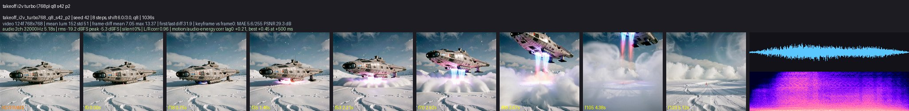

**Room walkthrough image-to-video, seed 42** ([clip](assets/minimax-h3/room_i2v_turbo544_q8_seed42.mp4),
[keyframe](assets/minimax-h3/keyframe_room.png), [prompt](assets/minimax-h3/prompt_room_i2v.txt)): a
first-person prompt on a `880x1168` watercolor painting of a living room, which the 544p entry maps to
a portrait `544x736` canvas. The camera walks across the rug toward the leather couch, lowers as it
sits, a hand reaches out and opens the nearest laptop until its screen faces us, and the view turns to
the bay windows, the round table and the trees outside, all in the painting's style. The park track
stays quiet until birdsong takes over in the second half (1 to 8 kHz carrying up to 75% of the energy)
with a lid click on top; the motion/audio-energy correlation peaks at 0.42. Frame 0 matches the
downscaled keyframe at PSNR 24.8 dB; 10.2 min for 8 steps and both decodes. Fast
object manipulation is where the 8-step adapter is weakest: a handled object can settle into a new
orientation over a few frames instead of rotating continuously through them, so name the pivot and
anchor the object as the prompt above does.

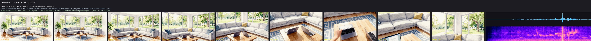

**Ocean waves, seed 42** ([clip](assets/minimax-h3/ocean_turbo544_q8_seed42.mp4),
[prompt](assets/minimax-h3/prompt_ocean.txt)): waves break over basalt rocks with a large spray
mid-clip while sea birds cross the sky; the broadband ocean track (-29.5 dBFS RMS) swells with the
break.

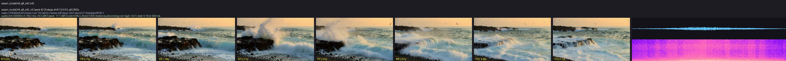

**Spoken dialogue, seed 42** ([clip](assets/minimax-h3/speech_turbo544_q8_seed42.mp4),
[prompt](assets/minimax-h3/prompt_speech.txt)): one speaker written as
`The woman with a clear, warm mid-pitched voice (S1) says: <d>[English] ...</d>` in the description,
with the kitchen ambience in the soundscape and no score. The model animates her mouth through the
line and generates the voice: the track is dominated by the 300 Hz to 3 kHz speech band in syllabic
bursts, its voiced pitch sits at a 219 Hz median, and the mouth region's motion follows the audio
envelope at a 0.54 correlation. Dialogue is generated speech, not a voice you supply; voice-timbre
references belong to the unported reference-to-video route.

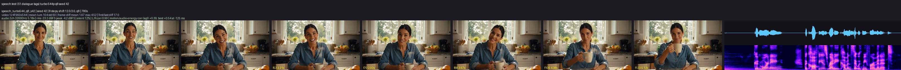

**Fox at 768p, seed 42** ([clip](assets/minimax-h3/fox_turbo768_q8_seed42.mp4)): the same prompt
through `minimax-h3-turbo` on its native `1344x768` canvas (8 steps, 34 min). Denser fur and snow
detail than the 544p clips, the same walk-then-look-at-camera staging, and a quiet stereo track with
the paw crunches tracking the motion.

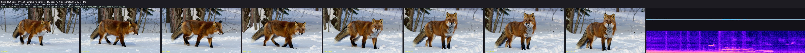

**Wan2.2 TI2V-5B on the fox description** ([clip](assets/minimax-h3/fox_wan_ti2v5b_q8_seed42.mp4)):
the visual part of the same prompt through the silent Wan route (`832x480`, 121 frames, 50 steps,
23 min). Included as a reference point for pacing and style, not as a like-for-like quality
comparison: the two models have different canvases, schedules, and training data, and only MiniMax-H3
generates the soundtrack.

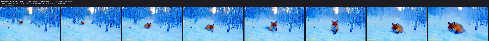

**Street guitarist, seed 42** ([clip](assets/minimax-h3/guitar_turbo544_q8_seed42.mp4),
[prompt](assets/minimax-h3/prompt_guitar.txt)): a slow dolly-in on a fingerpicking musician; the
spectrogram shows the plucked-string harmonics and rhythm of the on-camera guitar (-14 dBFS RMS,
stereo correlation 0.88).

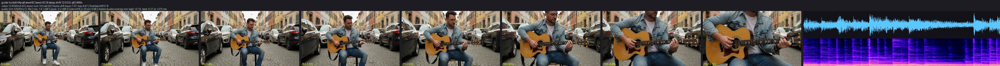

**Community character adapter, with and without** ([prompt](assets/minimax-h3/prompt_skeletor.txt);
clips [without](assets/minimax-h3/skeletor_off_turbo544_640x352_q8_seed42.mp4),
[with, seed 42](assets/minimax-h3/skeletor_on_turbo544_640x352_q8_seed42.mp4),
[with, seed 7](assets/minimax-h3/skeletor_on_turbo544_640x352_q8_seed7.mp4), each with its
`.metadata.json` beside it): the civitai
"Skeletor" adapter (`H3_Skeletor_1.4.safetensors`, ai-toolkit 0.12.18, rank 8, original-checkpoint
key layout, 416 keys) stacked at scale 1.0 on the 544p Turbo adapter, `640x352`, 124 frames, 8
steps. Top: the same prompt and seed 42 through the Turbo adapter alone, which reads the name as a
generic bone skeleton king with a golden horned crown. Middle: seed 42 with the adapter, the
Masters of the Universe character (purple hood and collared cape, blue body, bare skull with red
eyes, ram-skull staff with glowing green eyes), on the same push-in. Bottom: seed 7 with the
adapter, the same character in a different pose and framing. Same-seed runs of this runtime are
byte-identical, so the whole middle-versus-top difference (frame PSNR median 15.7 dB, audio
correlation 0.04) is the adapter; the voice line changes with it. The adapter costs about 1% per
linear layer (rank 8 next to Turbo's rank 128).

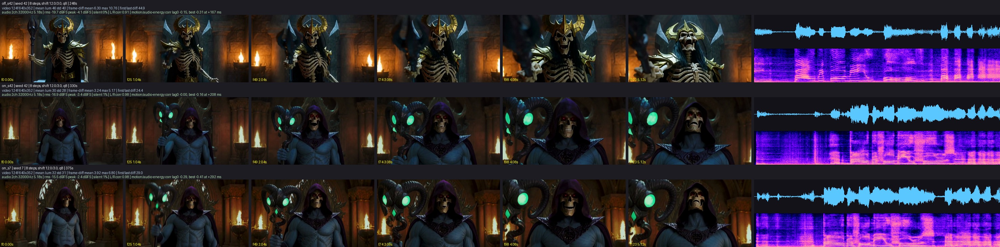

**Turbo step counts** ([8-step adapter at 4 steps](assets/minimax-h3/turbo544_8step_adapter_4steps_640x352_q8_seed42.metadata.json),
[4-step v1.2 adapter at 4 steps](assets/minimax-h3/turbo_4step_v1.2_adapter_4steps_640x352_q8_seed42.metadata.json),
[4-step v1.2 adapter at 8 steps](assets/minimax-h3/turbo_4step_v1.2_adapter_8steps_640x352_q8_seed42.metadata.json)):
the Skeletor prompt above through the Turbo adapters alone, seed 42, `640x352`, 124 frames. Top to
bottom: the 544p 8-step adapter at 8 steps (the with/without reference clip, 248 s), the same
adapter at 4 steps (80 s; same staging, slightly higher contrast, the spoken line and laugh
intact), the 4-step v1.2 768p adapter at 4 steps with `--video-shift 6` (133 s; brighter, more
saturated, more armor detail), and that adapter at 8 steps (401 s on a warm machine; close to its
4-step result). Every row speaks the line; the rows differ in look, not in coherence.

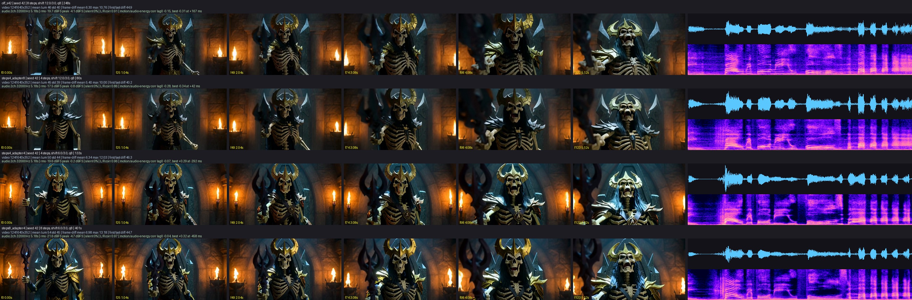
