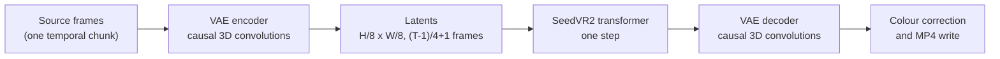
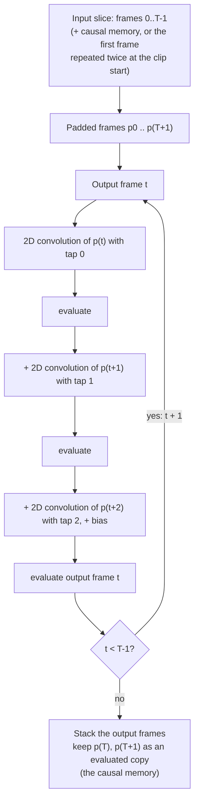

# SeedVR2 Video Memory

A SeedVR2 video restoration spends most of its working memory in the VAE, the network that turns
frames into latents and latents back into frames. This page explains what the VAE does in a
restoration, why it needed so much memory on MLX 0.32, how MLX-Gen 0.40.2 runs it, what that
changes in memory, speed and output, and what limits the frame size now. It complements
[Image and video upscaling](upscaling.md), which covers commands, models and quality proofs, and
[API and CLI](api.md#planning-the-clis-video-profile-from-python), which covers planning a run from
Python.

## Summary

- **Routes**: SeedVR2 video restoration (`mlxgen upscale --video-path`,
  `SeedVR2.restore_video_to_path`) and, through the same layers, SeedVR2 image restoration.
- **How it runs**: each causal 3D convolution of the VAE sums its temporal taps one output frame
  at a time, evaluates every convolution as it completes, and keeps its causal memory as a copy of
  two frames.
- **Output**: identical, bit for bit. Restored MP4s and images have the same SHA-256 as with
  0.40.1's VAE.
- **Memory**: a 17-frame 640x352 restoration works in 7.0 GB instead of 62.5 GB. From about
  320x192 up, the VAE needs 28 to 32 KB per output pixel instead of about 190 KB, little dependent
  on the chunk length; below about 128x128 (16,384 pixels) part of the decoder keeps MLX's single
  call and the VAE needs up to 1.3 GB whatever the size.
- **Speed**: the same or faster: 640x352 x 17 restores in 14.9 s instead of 20.5 s.
- **Largest frame**: on the safe profile's 48 GB budget, about 1.4 megapixels per frame
  (1552x880 for a 17-frame 16:9 clip); 1280x720 is admitted, a larger frame is refused before the
  model loads. 0.40.1 left the VAE out of its plan and let such frames swap: a 49-frame 720p chunk
  peaked at 172 GB.
- **What changes for you**: 640x352 to 1280x720 restorations run on the safe profile, and the plan
  counts the VAE when it sizes temporal chunks, which keeps long clips in long chunks. There is no
  new option.

## What The VAE Does In A Restoration

A restoration processes the clip in temporal chunks. For each chunk, the VAE encoder turns the
frames into latents (8 times smaller in height and width, 4 times fewer frames), the SeedVR2
transformer restores the latents in one step, and the VAE decoder turns them back into frames,
which are colour-corrected and written to the MP4.



Both halves of the VAE are stacks of causal 3D convolutions: each output frame depends on its own
input frame and the two before it (three temporal taps). The encoder and decoder walk through a
chunk in temporal slices of four to five frames, and each causal convolution keeps the frames the
next slice needs (its causal memory): two frames, one for the stride-2 temporal downsamplers.
Every layer works on whole frames: the largest tensors are the decoder's last blocks at the full
output size.

## Why It Cost So Much On MLX 0.32

Measured on MLX 0.32.5 with 0.40.1's VAE code, which handed each causal convolution to MLX as one
3D convolution call:

- **Per-tap scratch.** MLX 0.32 runs a 3D convolution as one batched 2D convolution per temporal
  tap and keeps every tap's scratch until the whole call completes. One call peaks at about 20
  times its input: 6.13 GB for a 256-channel, 5-frame call at 320x192, against 0.45 GB on MLX 0.31.
- **Stacked lazy evaluation.** MLX evaluates lazily and frees a convolution's scratch only when the
  command buffer that ran it completes, so the scratch of several convolutions sharing a buffer was
  alive at once.
- **Pinned causal memory.** The causal memory was a view of the convolution's padded input, which
  kept that whole input alive until the next slice.

Together they made the VAE about 190 KB per output pixel: 62 GB for a 17-frame 640x352 chunk, and
an estimated 251 GB at 1280x720. 0.40.1 did not count the VAE in its plan, so such frames were
planned as safe and swapped; counted with these convolutions, the plan could only have admitted
frames up to about 560x304 on a 48 GB budget.

## How 0.40.2 Runs A Causal 3D Convolution

`CausalConv3d` in
[`src/mflux/models/seedvr2/model/seedvr2_vae/common/conv3d.py`](../src/mflux/models/seedvr2/model/seedvr2_vae/common/conv3d.py)
computes the same sums itself, one output frame at a time:



- The taps are summed in the order MLX sums them, and each 2D convolution is the one MLX would run
  for that tap, so the result is bit-identical; only one tap's scratch is alive at a time.
- Every convolution's output is evaluated before the next layer runs, so scratch cannot stack in
  one command buffer.
- The causal memory is an evaluated copy of the two frames the next slice needs, not a view of the
  whole padded input.

The per-frame sums are used only in the cases verified bit-identical to MLX's single call on MLX
0.32.5: batch 1, unit stride, input channels a multiple of 16, output channels at most 16 or a
multiple of 16, and frames of at least 4096 pixels. These are the cases measured, not MLX's own
rule: with a batch of 2, with 17 to 31 or 100 output channels, or with smaller frames the sums
differ. Every other convolution keeps the single 3D call, still evaluated as it completes; in
SeedVR2 that is the 3-channel input layer, the strided downsamplers, and frames under 4096 pixels,
which for the decoder's half-resolution layers means outputs under 16,384 pixels.

## Measured Impact

Full restorations through the public Python path (the plan, a fresh 3B model with the plan's
memory profile, `restore_video_to_path` with the plan's values), synthetic 17-frame clips, seed 42,
`1x`, SeedVR2 3B (`numz/SeedVR2_comfyUI` source weights), MLX 0.32.5, an M5 Max with 128 GB.
Working peak is the MLX peak minus the 7.28 GB of resident weights; footprint is the process's
physical footprint (weights, working memory and the 8 GB MLX cache of the safe profile).

| Output, 17 frames | Working peak, 0.40.1's VAE | Working peak, 0.40.2 | Footprint, 0.40.1's VAE | Footprint, 0.40.2 | Restore time, 0.40.1's VAE | Restore time, 0.40.2 | Output |
|---|---|---|---|---|---|---|---|
| 320x192 | 17.09 GB | 1.93 GB | 23.9 GB | 17.0 GB | 5.3 s | 4.8 s | identical |
| 480x272 | 36.11 GB | 4.08 GB | 33.9 GB | 18.3 GB | 10.8 s | 9.2 s | identical |
| 640x352 | 62.49 GB | 7.03 GB | 47.5 GB | 21.4 GB | 20.5 s | 14.9 s | identical |
| 960x528 | not run (estimated 138.9 GB) | 15.80 GB | - | 28.5 GB | - | 32.9 s | layer-level identity |
| 1280x720 | not run (estimated 251.0 GB) | 28.72 GB | - | 40.5 GB | - | 60.9 s | layer-level identity |
| 480x272, 97 frames in one chunk | - | 4.22 GB | - | 18.9 GB | - | 47.6 s | layer-level identity |

The footprint falls less than the working memory because it also holds the 7.28 GB of weights and
up to 8 GB of MLX cache, the safe profile's cache limit. Times vary by about 20% between runs of the
same restoration on this machine (the calibration runs of 0.40.2 took 3.4, 6.8 and 12.4 s at the
first three sizes).

The working memory no longer grows with the chunk length: at 640x352 it is 2.4 GB for one
frame and 7.0 to 7.3 GB from 9 to 97 frames.

## Identical Output

At 320x192, 480x272 and 640x352 (17 frames, seed 42), the restored MP4s have the same SHA-256 as
those of 0.40.1's VAE, and the float frames handed to the video writer are equal bit for bit. A
SeedVR2 image upscale (64x64 to 128x128, seed 42) writes the same PNG bytes. End-to-end identity
is shown where the previous code could run; at the larger sizes it rests on layer-level identity:
every convolution SeedVR2 builds gives the same bits as the single call, checked on 6,000 cases
at the real layer shapes, including large frames and every slice sequence. The 640x352 reference
was run once with 0.40.1's VAE and `--force-unsafe-video-memory`, whose memory checks would
otherwise have stopped it.

## What Changes For You

- **Larger outputs run.** Frames up to the limit below run on the safe profile, with the memory
  checks in force: 640x352, 960x528 and 1280x720 at `1x` need no `--force-unsafe-video-memory`.
- **Temporal chunks.** The plan picks the largest chunk that fits the memory budget, counting the
  VAE. 0.40.1 left the VAE out of its estimate, so a chunk is never longer than 0.40.1 planned it;
  with the VAE this small, long clips keep long chunks, often the whole clip (a 97-frame 480x272
  clip runs as one chunk on a 48 GB budget, where counting 0.40.1's VAE would have cut it to 81-frame
  chunks). Explicit `--temporal-chunk-size` and `--temporal-chunk-overlap` are kept as given.
- **No new option, no new plan field.** `SeedVR2VideoRestorePlan` keeps its fields; only what it
  admits changes.

## Limits

The VAE still works on whole frames. What remains grows with the frame area, little with the
chunk length: the whole-frame activations of one temporal slice, largest in the decoder's last,
full-resolution blocks, and each convolution's causal memory, 28 to 32 KB per output pixel from
about 320x192 up. Below that the estimate uses a floor of 1.4 GB, above every small frame measured
(0.60 to 1.32 GB from 64x64 to 144x112). The table is calibrated on SeedVR2 3B; the 7B variants use
the same VAE, but their working set was not measured. The plan refuses an output frame
whose smallest allowed chunk does not fit the budget (half of the memory available when the plan
is made, at most 48 GB), with the reason `beyond_memory_profile`, the size that does not fit, and
the largest output that fits with the `--resolution` to ask for.

On a 48 GB budget the largest output is about 1.4 megapixels per frame (1552x880 for a 17-frame
16:9 clip); 1280x720 is admitted and 1920x1080 (1920x1072 after cropping to a multiple of 16) is
refused:

```text
SeedVR2 video restore cannot fit a 1920x1072 output frame in this machine's video memory budget (48.0 GB): the VAE works on whole frames, so this size needs about 70.8 GB whatever the temporal chunk size. The largest output that fits is 1552x880 (1365760 pixels per frame): use --resolution 880 or smaller, or --force-unsafe-video-memory to run this size anyway.
```

The budget follows the memory available when the plan is made, so a Mac with less free memory gets
a lower limit. Scales above `1x` remain refused on the safe profile, whatever the frame size.

The per-frame sums rest on MLX 0.32's convolution dispatch. The memory table and the tap guard are
tied to `SeedVR2Util.VIDEO_VAE_MEMORY_MLX_RANGE` (0.32.4 to below 0.33); a new MLX version needs
the bitwise test below and the memory table re-checked before the range is widened.

## Usage

Restore 49 frames of a 1280x720 clip at its own size. The plan is made before the model loads, so
a frame that does not fit is refused at once:

```sh
mlxgen upscale \
  --model seedvr2-3b \
  --video-path clip_720p.mp4 \
  --max-frames 49 \
  --seed 42 \
  --output clip_720p_restored.mp4
```

From Python, plan first, then pass the plan's values:

```python
from mflux.callbacks.instances.memory_saver import MemorySaver
from mflux.models.common.config.model_config import ModelConfig
from mflux.models.seedvr2 import SeedVR2, SeedVR2VideoRestorePlan, SeedVR2VideoRestoreRefused

model_config = ModelConfig.seedvr2_3b()
try:
    plan = SeedVR2VideoRestorePlan.for_video("clip_720p.mp4", model_config=model_config, max_frames=49)
except SeedVR2VideoRestoreRefused as refused:
    raise SystemExit(f"{refused.reason}: {refused}")

model = SeedVR2(model_config=model_config)
model.callbacks.register(
    MemorySaver(model, keep_transformer=plan.keep_transformer, cache_limit_bytes=plan.cache_limit_bytes)
)
model.restore_video_to_path(
    seed=42,
    video_path="clip_720p.mp4",
    output_path="clip_720p_restored.mp4",
    resolution=plan.resolution,
    start_seconds=plan.start_seconds,
    max_frames=plan.max_frames,
    temporal_chunk_size=plan.effective_chunk_size,
    temporal_chunk_overlap=plan.effective_chunk_overlap,
    enforce_memory_budget=plan.enforce_memory_budget,
)
```

## How It Is Validated

Fast tests, no weights needed:

| Test | What it checks |
|---|---|
| `tests/seedvr2/test_seedvr2_causal_conv3d_exact.py::test_causal_conv3d_is_bitwise_the_single_3d_convolution_across_chunks` | Across a 5-frame, a 1-frame and a 4-frame slice, in the VAE's dtype mixes (bfloat16 or float32 activations, float16 weights), output and causal memory equal the single 3D call bit for bit, and the expected path runs: the per-frame sums for the verified cases (including exactly 4096 pixels and 3 output channels), the single call for 20 output channels, a batch of 2, 3 input channels, 40x40, 60x64 and 63x65 frames, and stride 2 above 4096 pixels. It fails if a new MLX changes its algorithm switch. |
| `tests/seedvr2/test_seedvr2_causal_conv3d_exact.py::test_the_vae_layers_that_run_on_large_frames_take_the_taps` | Every unit-stride causal convolution of the real VAE layout with a multiple of 16 input channels takes the per-frame sums on a 64x64 frame. |
| `tests/seedvr2/test_seedvr2_causal_conv3d_exact.py::test_the_taps_need_a_fraction_of_the_single_call_memory` | On a 128-channel, 5-frame, 128x128 layer the per-frame sums peak at under a quarter of the single call (measured: 0.07 against 0.94 GB). |
| `tests/seedvr2/test_seedvr2_causal_conv3d_exact.py::test_a_slice_leaves_only_its_output_and_a_two_frame_memory_alive` | After a slice, only its output and a two-frame causal memory stay allocated. |
| `tests/seedvr2/test_seedvr2_causal_conv3d_exact.py::test_the_causal_memory_takes_the_dtype_of_the_next_slice`, `test_causal_conv3d_disabled_state_keeps_no_memory` | The memory is cast to the next slice's dtype; without temporal slicing the result is the same and no memory is kept. |
| `tests/seedvr2/test_seedvr2_causal_conv3d_exact.py::test_the_tap_guard_was_read_from_the_installed_mlx` | The installed MLX is inside the range the guard and the memory table were measured on. |
| `tests/seedvr2/test_seedvr2_video_vae_memory.py` | The estimate covers every measured working peak (39 points, 64x64 to 1280x720, 1 to 97 frames) and is at most 1.3 times it wherever the per-pixel term applies; the 1.4 GB floor is above every small frame; the table is the measured one; 640x352 and 1280x720 are admitted on a 48 GB budget; 1920x1072 is refused before any model load with the largest size that fits; the run-time check uses the same estimate. |

```sh
uv run python -m pytest -q tests/seedvr2/test_seedvr2_causal_conv3d_exact.py tests/seedvr2/test_seedvr2_video_vae_memory.py
```

The memory figures, timings and byte-identity results above come from full restorations on the
real weights, as described in [Measured Impact](#measured-impact).
