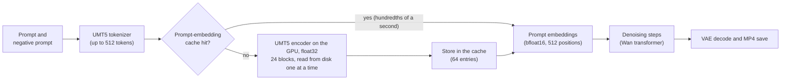
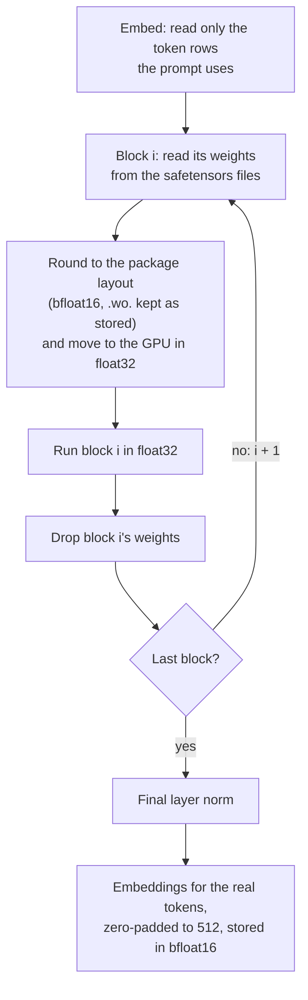

# Wan Prompt Encoding

Every Wan run turns its prompt (and its negative prompt) into embeddings with the UMT5-XXL text
encoder before the first denoising step. This page explains how MLX-Gen 0.40.2 runs that encoder,
what it costs in time and memory, how faithful its result is, and what changes for you compared
with 0.40.1 and earlier. It complements [Wan video](wan-video.md), which covers sizes, routes and
commands, and [Python integration](python-integration.md), which covers embedding Wan in an
application.

## Summary

- **Routes**: every route that encodes a prompt with UMT5: Wan 2.2 text-to-video,
  image-to-video and video-to-video (`T2V-A14B`, `I2V-A14B`, `TI2V-5B`), Wan 2.1 VACE
  (`wan-vace`), and Bernini-R ([Bernini-R 1.3B](bernini.md)).
- **How it runs**: the encoder computes in float32 on the GPU, and its weights are read from the
  model files one transformer block at a time, so an encode holds about one block in memory
  instead of the whole encoder.
- **Speed**: a new prompt is encoded in 1.2 to 3.9 s (0.40.1 and earlier: 72 to 87 s). A VACE run
  with a new prompt reaches its first denoising step in 20 to 22 s instead of 88 to 105 s.
- **Memory**: about 1.2 GiB is added while the first prompt of a process is encoded, 0.3 to
  0.4 GiB for later prompts, and returned within seconds. Run peaks are unchanged.
- **Fidelity**: the encoder output is within 7.6e-6 of a CPU float32 computation. 0.40.1 and
  earlier were up to 0.155 away.
- **What changes for you**: for a given prompt and seed, a Wan video differs slightly from the one
  0.40.1 produced, and prompt embeddings cached on disk by earlier versions are not reused. There
  is no new option to set.

## What The Text Encoder Does In A Wan Run

The tokenizer turns the prompt into at most 512 UMT5 tokens (`--max-sequence-length`, default
`512`; longer prompts are truncated with a warning). The encoder turns those tokens into one
4096-value embedding per token. The denoising transformer reads these embeddings at every step, so
the encoder runs once per new prompt, and a prompt already encoded is served from the
[prompt-embedding cache](#the-prompt-embedding-cache) without running the encoder.



The encoder weights are about 11.4 GB on disk (the `text_encoder/` folder of every Wan package).
They are stored in bfloat16; the Bernini package also keeps the feed-forward output layers
(`.wo.`) in float32.

## 0.40.1 And Earlier

Up to 0.40.1, MLX-Gen loaded the whole encoder into torch on the CPU in bfloat16 and ran it on
the prompt padded to 512 tokens. Measured on an M5 Max with 128 GB of memory:

- encoding a new prompt took 72 to 87 s;
- a VACE run with a new prompt reached its first denoising step after 88 to 105 s, while its eight
  denoising steps take about 55 s, so most of the wait for a short clip was prompt encoding;
- a prompt already used was served from the prompt-embedding cache in a few hundredths of a
  second;
- the bfloat16 computation deviated from a float32 computation of the same encoder by up to 0.155
  (mean 0.0012) on embedding values that reach 1.65.

## How 0.40.2 Encodes A Prompt

The encoder is `WanTextEncoder` in
[`src/mflux/models/wan/wan_text_encoder.py`](../src/mflux/models/wan/wan_text_encoder.py). It
uses the reference `transformers` UMT5 encoder's own forward pass, built without storage, and
supplies its weights block by block:

1. The encoder structure is built empty (no weights), and the safetensors files are indexed.
2. Only the embedding rows of the tokens present in the prompt are read from the 2 GB token
   table.
3. Just before each of the 24 transformer blocks runs, its weights are read from the safetensors
   files and moved to the GPU in float32; right after the block runs, they are dropped.
4. The batch runs at the length of its longest real prompt rather than 512 tokens. Padded
   positions receive exactly zero attention, so the real tokens' embeddings do not depend on the
   padding; the result is padded back to 512 positions with zeros, the layout the denoiser
   expects.
5. After the encode, successful or not, no weight remains loaded and the GPU allocator returns its
   staging memory to the system.



The computation runs on the GPU through PyTorch's Metal (MPS) device; on a machine without it, the
same float32 computation runs on the CPU. Weights are rounded to bfloat16 exactly as the packages
store them (every weight except the `.wo.` layers), so a float32 source repository and its
bfloat16 package give identical embeddings. The embeddings handed to the denoiser are bfloat16, as
in earlier versions.

## Measured Impact

Measured on real weights on an M5 Max with 128 GB of memory, with the encoder files in the OS file
cache.

| | 0.40.1 and earlier | 0.40.2 |
|---|---|---|
| Encode a new prompt | 72 to 87 s | 1.2 to 3.9 s (2.4 s typical for the first prompt of a process, torch import included) |
| VACE 1.3B, new prompt, 17 frames 832x480: call to first denoising step | 88 to 105 s | 20 to 22 s |
| Wan 2.2 T2V-A14B video-to-video, new prompt: call to first denoising step | not measured | about 14 s |
| Prompt already in the cache | a few hundredths of a second | unchanged |
| Memory added while encoding | about 0.5 GiB | about 1.2 GiB for the first prompt, 0.3 to 0.4 GiB for later ones, returned within seconds |
| Run peak, VACE 17 frames 832x480 | 28.5 to 29.3 GiB | unchanged |
| Run peak, VACE with `--low-ram` | 18.7 GiB | unchanged |
| Largest deviation from a CPU float32 encode | 0.155 (mean 0.0012, values up to 1.65) | 7.6e-6 |

Two other ways of running the encoder were measured and not adopted:

| Alternative | Encode time | Result |
|---|---|---|
| Whole encoder in float32 on the GPU | 3.3 s | holds 29 GiB while encoding |
| Whole encoder in float16 on the GPU | fast | deviates by up to 3.28 from float32: unusable |

Block streaming gives the float32 result at a speed close to the whole float32 encoder's while
holding about one block, in every mode including `--low-ram`.

## What Changes For You

### Results For A Given Seed

For a given prompt and seed, a Wan video made with 0.40.2 differs slightly from the one 0.40.1
made: the scene and composition are the same, and details differ, because the embeddings that
guide the denoiser are now the float32 encoder's. Measured on one VACE clip, the two versions'
outputs are about 25 to 27 dB PSNR apart. Within 0.40.2, results are reproducible: the CLI and the
Python API give byte-identical videos for the same request.

### Compatibility With 0.40.1 Results

A clip made with 0.40.1 or earlier cannot be reproduced bit for bit with 0.40.2, whatever the
options. If you need to reproduce such a clip exactly, install the version that made it, for
example:

```sh
uv tool install --force "mlx-gen==0.40.1"
# or, in an environment
python -m pip install "mlx-gen==0.40.1"
```

The clip's run metadata records the prompt, seed and settings to reuse. New work is best done with
0.40.2, whose embeddings match the reference encoder.

### The Prompt-Embedding Cache Starts Afresh

Cache keys include the encoding method (`WanTextEncoderLoader.ENCODE_POLICY_ID`, in
[`wan_text_encoder_loader.py`](../src/mflux/models/wan/wan_text_encoder_loader.py)), so entries
written by 0.40.1 and earlier never match and are never served. The first run of each prompt
encodes it again, in seconds, and the old entries leave the cache as new prompts are stored. You do
not need to clear anything.

### Keeping The Encoder Between Prompts

`--keep-text-encoder` (CLI) and `keep_text_encoder_resident=True` (Python) still keep the encoder
between generations in one process. Since the weights are read for every new prompt either way,
the kept encoder holds only its empty structure and file index (a few MB), and the option saves
under a second per new prompt. The default builds the encoder for each new prompt and releases it
afterwards.

### Options

No option is added, removed or renamed. `--low-ram` runs need nothing: the encoder holds about one
block in every mode.

## The Prompt-Embedding Cache

Wan stores the embeddings of each encoded prompt on disk, so a prompt already used skips the
encoder. The store is `WanPromptEmbedStore` in
[`src/mflux/models/wan/prompt_embed_store.py`](../src/mflux/models/wan/prompt_embed_store.py).

- **Location**: `~/Library/Caches/mflux/prompt_embeds/wan`, one small safetensors file per entry.
- **Size**: 64 entries; the least recently used entry is removed when a new one is stored.
- **Hit**: the same tokenized prompt (prompt text and tokenizer settings), sequence length and
  precision, for the same encoder files (path, file names, sizes and modification times), the same
  installed `torch` and `transformers` versions, and the same encoding method. Changing any of
  these encodes the prompt again. A hit does not import torch.
- **Opt out**: `--no-prompt-cache` (CLI) or `prompt_embed_disk_cache=False` (Python).
- **Clear**: delete the folder; it is recreated on the next encode.

```sh
rm -rf ~/Library/Caches/mflux/prompt_embeds/wan
```

## Usage

Prompt encoding needs no option. A Wan 2.2 TI2V-5B text-to-video run, from
[Wan video](wan-video.md#command-shape):

```sh
mlxgen generate \
  --model AbstractFramework/wan2.2-ti2v-5b-diffusers-8bit \
  --prompt "A cinematic wide-angle movie shot of a massive futuristic starship taking off from a frozen tundra. The ship features sleek dark metallic armor. Two massive warp nacelles pulsate with intensely glowing blue plasma. Violent snow squalls and heavy blizzards whip around the hull. The swirling snow is illuminated by stark volumetric blue light from the engines. The camera slowly tilts up. The camera simulates a violent shake as the thrusters ignite. Massive clouds of pristine white snow and ice blast away from the launch pad. Photorealistic, highly detailed, dramatic lighting." \
  --width 832 \
  --height 480 \
  --frames 101 \
  --steps 25 \
  --guidance 5 \
  --flow-shift 3 \
  --fps 20 \
  --seed 42 \
  --output starship_takeoff_ti2v5b.mp4
```

A VACE run with a reference image and `--low-ram`, from
[Wan video](wan-video.md#vace-reference-images-and-learned-mask-conditioning):

```sh
mlxgen-generate-wan --model Wan-AI/Wan2.1-VACE-1.3B-diffusers \
  --reference-image ship_segmented_on_white.png \
  --prompt "The starship from the reference image flying low over a calm turquoise ocean at golden sunset, side view, large in frame, cinematic tracking shot, photorealistic" \
  --negative-prompt "duplicate ships, warped hull, washed out frame, blown highlights, tiny distant object" \
  --width 832 --height 480 --frames 17 --fps 16 --steps 20 --guidance 5.0 \
  --seed 4242 --low-ram --metadata --output ship_over_ocean.mp4
```

Running either command a second time with the same prompt serves the embeddings from the cache.
Add `--no-prompt-cache` to encode on every run, or `--keep-text-encoder` when one process chains
many new prompts.

From Python, a host that generates scene after scene with new prompts can keep the encoder
between calls:

```python
from mflux.models.wan.variants import Wan2_2_TI2V

model = Wan2_2_TI2V(
    model_path="Wan-AI/Wan2.2-TI2V-5B-Diffusers",
    keep_text_encoder_resident=True,
)
for index, prompt in enumerate(
    [
        "A slow cinematic shot of a glass sphere floating above teal water",
        "The glass sphere sinks slowly into the teal water, light rippling across its surface",
    ]
):
    video = model.generate_video(
        seed=321,
        prompt=prompt,
        width=1280,
        height=704,
        num_frames=121,
        num_inference_steps=50,
        fps=24,
    )
    video.save(f"sphere_{index}.mp4")
```

Through the route-resolved runtime, pass the same option with
`load_generation_model(..., model_kwargs={"keep_text_encoder_resident": True})`; see
[Python integration](python-integration.md#runtime-planning-and-loading).

## How It Is Validated

The behaviour is covered by fast tests in
[`tests/wan/test_wan_text_encoder.py`](https://github.com/lpalbou/mlx-gen/blob/main/tests/wan/test_wan_text_encoder.py), which run a small
randomly initialised UMT5 encoder of the real architecture, stored in safetensors shards the way
Wan packages are:

| Test | What it checks |
|---|---|
| `test_streamed_encode_matches_the_whole_float32_model_on_the_real_tokens` | The block-streamed encode equals the whole float32 model on the real tokens, and leaves no weight loaded. |
| `test_streamed_encode_is_the_whole_model_bit_for_bit_without_padding` | Without padding, the streamed encode is bit-identical to the whole float32 model. |
| `test_a_float32_source_encodes_exactly_as_its_package` | A float32 source and its bfloat16 package give identical embeddings. |
| `test_a_failed_encode_leaves_the_encoder_empty_and_reusable` | A failure inside a block leaves no weight and no hook behind, and the next encode gives the expected result. |
| `test_streamed_encode_on_the_gpu_matches_the_whole_float32_model` | On the Metal GPU, the encode matches the float32 model and returns all GPU memory. |
| `test_engine_encode_pads_to_the_sequence_length_and_releases_the_encoder` | The engine pads the embeddings to the sequence length with zeros, stores them in the model precision, and releases the encoder. |
| `test_resident_text_encoder_is_built_once_across_prompts` | With the resident option, the encoder is built once for several prompts. |
| `test_prompt_cache_key_no_longer_matches_entries_of_the_bfloat16_cpu_encoder` | The cache key differs from the one 0.40.1 computed for the same prompt. |

Run them with:

```sh
uv run python -m pytest -q tests/wan/test_wan_text_encoder.py
```

The timings, memory figures and fidelity figures in [Measured Impact](#measured-impact) were
measured on the real Wan weights.

## Limits

- Encoding a new prompt needs `torch` and `transformers`, as before; a cache hit does not.
- The first new prompt of a process includes importing torch, which is why it takes longer than
  later ones.
- Timings assume the encoder files are in the OS file cache; reading the 11.4 GB from disk for the
  first time in a session adds the time that read takes on your storage.
- Bit-identical results hold within one installed version of MLX-Gen, MLX, `torch` and
  `transformers`.
